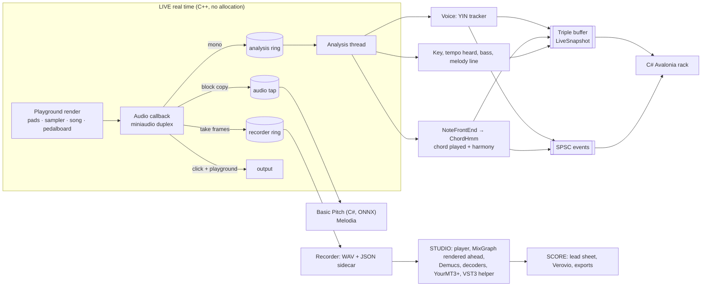

# Implementation

What Dissonância is today, measured against what it was specified to be.

The original specification (`docs/spec.md` V2.3, `docs/spec.v2.1.md`) and the STUDIO plan
(`docs/studio-plan.md`) were removed on 2026-10-21. They live in git history (last version at
commit `4d1fca3`; code comments that cite `§n` or `studio-plan Sn` refer to that version). This
file replaces them: every requirement they set is listed below with
what was built, what changed by a later decision and what is still open. The current requirements are
[`REQUIREMENTS.md`](REQUIREMENTS.md) and the plan is [`ROADMAP.md`](ROADMAP.md).

Status on 2026-10-21:
- Core: 71 Catch2 cases, 5952 assertions, all pass (`core/build/dz_tests`).
- App checks: 128 checks in `tests/score`, all pass.
- Platforms: built and run on Linux (WSL2 + WSLg) only. Windows and macOS are not verified.
- CI: none. Nothing runs the tests on a push.
- Real use: the user has sung into a microphone and played YouTube songs whose chords they know.
  Their estimate is that about 80 % reads right. That is a judgement, not a measurement.

## Requirements against the build

Status words: **Done** (built as specified), **Changed** (built differently by a later decision,
listed under "Decisions that changed the spec"), **Partial**, **Open** (not built), **Dropped**.

### Product shape

| Requirement (spec) | Status | Where / notes |
|---|---|---|
| Offline desktop app, no cloud, no account, no web build (§0) | Done | Downloads only fetch pinned upstream components (Setup) |
| Four tabs: START, LIVE, STUDIO, SCORE (§0, §22) | Done | `app/Program.cs` |
| LIVE: lowest latency, visual feedback only (§0, §4) | Changed | The playground makes LIVE produce sound: pads, sampler, pedalboard on the output |
| LIVE never writes files (§0) | Changed | REC writes takes (always did); the playground saves loops and bounces to STUDIO |
| No neural networks in LIVE (§0) | Changed | LIVE Melodia runs Basic Pitch (ONNX, CPU) |
| Fixed modes chosen before the session, no runtime switching (§5) | Changed | Five LIVE modes over the core's pipelines; STUDIO keeps the old five `AnalysisMode`s |
| LIVE → STUDIO → SCORE flow (§0, decision 2026-10-02) | Done | A LIVE take opens on STUDIO's tracks |
| v1.0 = M0–M6 accepted before any STUDIO work (§24) | Dropped | STUDIO S1–S11 were built while the v1.0 acceptance items stayed open |
| Never fake certainty: confidence, alternatives, reasons (§0) | Done | Chord reasons, `incerta` keys, DÚVIDA ▶ in review |
| Placement rule: expensive, look-ahead or whole-take work only in STUDIO (§0) | Done | Except Melodia's neural notes (0.5–1 s window) |

### Stack (§1)

| Requirement | Status | Notes |
|---|---|---|
| C++20 core, C ABI, P/Invoke | Done | `core/include/dissonancia.h`, `app/Native.cs` |
| C# .NET 10, Avalonia | Done | Avalonia 12.1.3 |
| miniaudio capture, WASAPI shared / exclusive, CoreAudio, ALSA, JACK, PipeWire | Partial | miniaudio picks the backend; START offers device, rate, period, exclusive. No backend selector |
| No ASIO unless WASAPI misses 20 ms on a real interface | Open | WASAPI never measured |
| demucs.cpp for separation, ONNX Runtime optional | Done | Plus YourMT3+ and Basic Pitch on onnxruntime, GPU via `Accel.cs` |
| VST3 SDK, out-of-process host | Done | `core/vst3/dz_plugin.cpp` |
| r8brain resampler in STUDIO | Changed | miniaudio's resampler (decoder and device) |
| WAV / FLAC / MP3 / OGG import | Partial | No OGG (stb_vorbis not added) |
| PocketFFT / pffft | Changed | Direct-form CQT; no FFT library needed so far |
| SIMD abstraction (AVX2 / NEON) | Open | Scalar code; measured cheap enough (CPU ≈ 1–2.5 %) |
| Verovio as a separate LGPL library | Done | Built from pinned source, loaded at run time |
| Catch2 + xUnit + RealtimeSanitizer + microbench | Partial | Catch2 and microbench yes; C# checks are a runnable program, not xUnit; no RTSan |
| Windows primary, Linux, macOS | Open | Only Linux (WSL2) verified |

### Real time (§3, §4)

| Requirement | Status | Notes |
|---|---|---|
| Callback: no allocation, lock, I/O; notify rule | Done | `rt_trap.cpp` aborts on `new` inside a real-time scope |
| Triple buffer snapshot, SPSC event queue with sequence numbers | Done | `lockfree.hpp` |
| Complete events only, flush on stop, gaps marked | Done | |
| Thread priority: MMCSS / SCHED_FIFO / QoS | Partial | Direct SCHED_FIFO; no rtkit, no macOS audio workgroup |
| FTZ / DAZ, pre-touched buffers | Done | |
| RealtimeSanitizer in CI | Open | No CI; needs Clang ≥ 20 |
| Page-fault counter in the GUI | Open | |
| Metronome on a separate output device (drift re-anchoring) | Open | Duplex device only |
| Loopback latency calibration | Open | The reported capture + playback latency is used |
| Reference machine fixed, CPU budgets measured on it | Open | All figures are from the dev machine |
| Capture ≤ 20 ms; first pitch ≤ 80 ms; stable ≤ 150 ms | Done (dev machine) | 15 ms reported capture; 30 / 50 ms |
| Chord confirmation 0.4–1 s | Changed | Chord played ~0.36 s, harmony ~0.55 s from a change to the screen |
| CPU ≤ 15 % Balanced; 0 xruns in 10 min | Done (dev machine, WSLg) | ≈ 1–2.5 %; 0 xruns in loopback runs |

### LIVE analysis (§5–§16)

| Requirement | Status | Notes |
|---|---|---|
| Mode × quality table, integer decimation | Done | `live_config.hpp` |
| Pre-processing: DC, HP, gate, RMS, peak, clip | Done | Adaptive silence gate (`noise_gate.hpp`) |
| Voice: YIN, median-of-3 tracker, vibrato kept, octave guard | Done | `voice.cpp` |
| YIN SIMD / FFT variant | Open | Not needed by measurement |
| Octave-decimated CQT, tuning sets, chroma | Done | `cqt.cpp` |
| NNLS chroma (bounded PGD) | Dropped | Replaced by perceived notes + HMM (`notes.cpp`) |
| Polyphonic notes with harmonic handling (§10) | Changed | `NoteFrontEnd`: A-weighting, Bark masking, virtual pitch, per register |
| Piano inharmonicity correction | Open | |
| Bass preview + CQT confirmation, computed settle | Done | `bass.cpp` |
| 180 templates, ambiguity reasons, tonal context | Done | Still the chroma path; chord modes now decode from notes |
| Chord tracker states, backdating, no overlap | Done | `ChordTracker::process_notes` |
| Guitar tunings, capo; voicing only as tie-break | Partial | In the ABI and the fretboard search; no START control |
| Arpeggio accumulation | Done | Including damped picking |
| Onsets, onset gating | Done | |
| Key fixed by the user; spelling D♭ ≠ C♯ | Done | Plus a heard key (`KeyTracker`) shown, never applied |
| Roman numerals, cadences (live, capped confidence) | Done | |
| Solfège (§18) | Open | Display layer v1.5, sung syllables v2 |
| A4 reference on START | Partial | In `SessionConfig`; no START control |

### SCORE and STUDIO (§17, §19–§21)

| Requirement | Status | Notes |
|---|---|---|
| Quantization, two timelines, ties, meter rules | Done | `Score.cs` |
| Pickup bar, swing, tuplets beyond eighth triplets | Open | |
| MusicXML (XSD-valid), MIDI type 1, JSON, text chart | Done | |
| MusicXML opened in MuseScore | Open | Manual check never done |
| Verovio view | Done | Re-engraved only when the tab opens |
| Accidental policy, courtesy accidentals, transposing instruments | Open | |
| Library, playback, peak mipmap | Done | S1 |
| Non-destructive editor | Partial | Trim, cut, clip gain, fades, normalize, undo; no split, copy / paste, mute region, gain envelope |
| Stage cache keyed by options + upstream | Done | Per stage key (edits, stems, inserts, taps) |
| Built-in effects (gain, HP / LP, EQ, gate) + compressor | Done | S4, then the lunchbox (S11) |
| Separation 2 / 4 / 6 stems | Partial | 4 and 6 stems; no 2-stem option |
| Per-stem transcription, YIN + MPM cross-check | Partial | Viterbi decoders; no MPM; YourMT3+ and Basic Pitch for instruments |
| Key suggestion, tempo map, corrections kept across re-runs | Done | S6 |
| Choir by section (experimental) | Done | S9, synthetic only |
| VST3: scan, render, latency, state, editor | Done | S8; Linux editor only checked |
| Mix-down and stems to WAV | Done | ENTREGAR |
| Themes dark + light; languages PT-BR + EN (§22.7) | Partial | Dark only; labels mixed PT / EN |

### GUI (§22)

| Requirement | Status | Notes |
|---|---|---|
| Rack modules, edit mode, presets per mode | Done | Reorder by buttons, not drag; one preset per mode |
| Stage mode, shortcuts, one action table | Done | |
| MIDI controllers via the action table (open item in the spec) | Done | Playground: RtMidi, MIDI learn |
| Zero allocation per frame in the C# render loop | Open | Text still allocates outside the cached strings; no check |
| ABI layout check at load | Done | Refuses a mismatched core |

## Decisions that changed the spec

Each one came from the user, after the spec was written.

- **2026-10-02:** STUDIO is built in studio order (S1–S9), not M7–M11. Key and meter belong to the
  user and never move by themselves. The STUDIO look is Dissonância's own rack, with a DAW's
  workflow.
- **2026-10-15:** STUDIO REC records through the core's recorder. The rack shows signal flow like
  a desk or a pedalboard.
- **2026-10-19:**
  - Five LIVE modes: Música completa, Melodia, Acústico, Acústico + voz, Piano.
  - Melodia runs Basic Pitch on the CPU. This is a neural model in LIVE.
  - ML ships natively (ONNX, ggml); Python is a dev tool only.
- **2026-10-20:**
  - Nothing is hosted: each machine fetches upstream files at pinned versions and builds its own.
  - LIVE chords come from perceived notes and an HMM, not from chroma templates.
  - LIVE leads with the harmony (triads); STUDIO shows the detail (sevenths, slash chords).
- **2026-10-21:**
  - STUDIO's chain is a lunchbox patched with cables. The cables are the mixer graph.
  - STUDIO renders about 1 s ahead for quality.
  - LIVE has a playground: pads, sampler, sequencer, song timeline, pedalboard, MIDI.

## Architecture as built

The session builds only the pipeline its mode needs: `voice_` for mono modes, the notes front end
and the chord tracker for chord modes. Nothing switches at run time.

## Code map

| Path | What it does |
|---|---|
| `core/include/dissonancia.h` | The whole C ABI: POD structs with explicit padding, `extern "C"` functions |
| `core/src/api.cpp` | ABI entry points |
| `core/src/engine.{hpp,cpp}` | LIVE session: callback, notify rule, analysis loop, meters, metronome, REC, sidecar |
| `core/src/lockfree.hpp`, `rt.{hpp,cpp}` | Triple buffer, SPSC queue; denormals, thread priority, real-time scope |
| `core/src/live_config.hpp` | Mode × quality table |
| `core/src/noise_gate.hpp` | Adaptive silence gate (minimum statistics) |
| `core/src/voice.{hpp,cpp}`, `theory.hpp` | Voice pipeline (YIN, tracker); speller |
| `core/src/halfband.hpp`, `cqt.{hpp,cpp}` | IIR half-band, octave-decimated CQT, chroma, tuning |
| `core/src/bass.{hpp,cpp}` | Onsets, bass preview + confirmation |
| `core/src/notes.{hpp,cpp}` | NoteFrontEnd (perceived notes) and ChordHmm (LIVE lag decoder, STUDIO whole-take decode) |
| `core/src/chords.{hpp,cpp}` | Templates, matcher, tracker (chroma and notes paths), Roman numerals, cadences, key tracker |
| `core/src/tempo.{hpp,cpp}` | Tempo heard (display only) |
| `core/src/playground.{hpp,cpp}`, `pedals.hpp` | Pads, sampler, sequencer, song timeline, overdub, bounce; six stompboxes on a patched board |
| `core/src/player.{hpp,cpp}` | STUDIO player: decode, edits, MixGraph rendered ahead, bounce |
| `core/src/mixdsp.hpp`, `loudness.hpp` | Strip and master DSP; BS.1770 / R128 loudness, true peak |
| `core/src/post.{hpp,cpp}`, `decode.{hpp,cpp}`, `sidecar.hpp` | Offline analysis job; whole-take chord and note decoders; take JSON |
| `core/src/beats.{hpp,cpp}` | Beat tracking (Ellis DP) |
| `core/src/choir.{hpp,cpp}` | Multi-f0 and SATB assignment (experimental) |
| `core/src/abi_check.cpp` | `static_assert` layout, `-Wpadded -Werror` |
| `core/tools/dz_wav.cpp` | Any WAV through the LIVE or STUDIO path (dev measurement) |
| `core/tools/dz_separate.cpp` | Demucs v4 helper process |
| `core/vst3/` | `dz_plugin` VST3 host helper (scan, render, params, editor) and the `DZ Test Gain` fixture |
| `core/tests/` | Catch2 cases; `rt_trap.cpp` aborts on allocation in a real-time scope |
| `app/Program.cs` | Window, tabs, START options, shortcuts |
| `app/Native.cs`, `LiveModel.cs` | P/Invoke mirrors and layout check; `Session`, `LiveFrame`, `FakeLiveSource` |
| `app/Rack.cs`, `Modules.cs`, `RackCatalog.cs`, `RackLayout.cs`, `Plasma.cs` | LIVE rack, module catalog, presets, plasma look |
| `app/LiveSong.cs`, `LiveTranscriber.cs`, `BasicPitch.cs` | Música completa (key, meter, form); Melodia's neural notes |
| `app/Playground.cs`, `PlaygroundModules.cs`, `SongMidi.cs`, `SampleBank.cs` | Playground state and units; MIDI file import / export; VCSL sounds |
| `app/Cables.cs` | Rope cables shared by the lunchbox and the pedalboard |
| `app/Studio.cs`, `StudioRack.cs` | STUDIO wrappers, project cache, library; the STUDIO rack |
| `app/EditList.cs`, `StudioSeparation.cs`, `StudioMix.cs`, `StudioPatch.cs`, `StudioLunchbox.cs`, `StudioMeters.cs`, `StudioPlugins.cs` | Edits, Demucs, mix model, patch graph, lunchbox, meters, VST3 |
| `app/YourMt3.cs`, `TorchCheckpoint.cs`, `Accel.cs` | YourMT3+ native; checkpoint reader; GPU detection and Setup |
| `app/Review.cs`, `LeadSheet.cs`, `Score.cs`, `Verovio.cs`, `SvgRaster.cs` | Review, lead sheet, score writers, engraving |
| `tests/score/` | Runnable checks for SCORE, rack presets, fretboard, playground, MIDI |
| `tools/loopback/` | Loopback test and evaluation scripts (GuitarSet, picking, mix, latency, choir) |
| `tools/yourmt3/` | YourMT3+ ONNX export and parity checks (dev only) |
| `tools/shot/` | Headless screenshots |

## What each part does

The sections below are the engineering record. They are grouped by part, not strictly by date.

### M0 — skeleton
- miniaudio duplex (or capture-only) device, 5 ms period requested, real rate
  and period read back. The capture latency shown is what the backend reports.
- The callback only downmixes into the analysis ring, copies the take window
  into the recorder ring, mixes the metronome click, and wakes the analysis
  thread when at least one hop is unread and the thread waits.
- The analysis thread publishes a complete `LiveSnapshot` every hop through a
  triple buffer. Discrete events go through the SPSC queue with sequence
  numbers, so a dropped event shows up as a gap.
- The metronome grid lives on the input sample clock. REC arms at the next bar
  plus the count-in and forces the metronome on. By default the click plays
  only in the count-in and stops at the first downbeat of the take, so a
  microphone does not record it (`AudioDeviceConfig.clickDuringTake = 1` keeps
  it for headphones). While counting in, `recordedSeconds` is negative (time
  to REC); LIVE shows a large count-in panel with the beats left. REC stop is
  100 ms ahead of the callback clock, so no block ever writes past it.
- Each take is a float32 WAV plus a JSON sidecar: session, device rate,
  input/output/compensation latency, start sample, gaps, and the complete
  note/chord events of the take (times from the first downbeat).
- Events are backdated by the round-trip latency (output + input), because
  the bar grid is where the click is generated.

### M1 — voice / instrument melody
- Integer FIR decimation to 16 or 22.05 kHz (delay compensated), high-pass at
  0.8 × f_min, YIN on an unwindowed frame. The instantaneous pitch is
  published every hop.
- The stable note comes from a median of 3, 0.7-semitone hysteresis and a
  30 ms minimum. Vibrato never splits a note. A repeated pitch after silence
  is a new note.
- Octave-down guard: when the CMND dip at half the chosen lag is under 0.25,
  the half lag wins (a decaying or breathy note can push the true-period dip
  just over the 0.15 threshold while the double-period dip stays under it).
- Notes are backdated to the energy onset (from silence) or, on a legato
  change, to the midpoint between the last hop whose own estimate still
  showed the old note and the first showing the new one, minus half a window
  (the frames between mix both notes and read unvoiced). Legato changes now
  start +4…+9 ms from the change (were +14…+34 ms). The energy onset counts only when newer than the
  last voiced hop, so an unvoiced gap above the gate does not pull a note back
  to the start of the phrase. The previous note ends exactly at the new onset.
- Spelling: key signature letters; chromatic notes by melodic direction (A→A♯→B,
  B→B♭→A); raised 6/7 in minor (G♯ in A minor, F𝄪 in G♯ minor); the octave
  follows the letter (C♭4 = MIDI 59); Treble 8vb clef.

### M2 — CQT, chroma, tuning
- Top octave at the live rate, each lower octave halved by the IIR half-band.
  One kernel set in normalized frequency is shared by all octaves. Each bin is
  one direct dot product (Hann, L = Q·fs/f, Q = 1.443 · bins per octave).
- Chroma removes main-lobe leakage into the neighbour bin, drops pitch classes
  20 dB below the strongest, log-compresses, smooths.
- Global tuning: the median deviation of many peaks selects one of 11
  precomputed kernel sets (−50…+50 cents), without allocation.

### M3 — chords
- Cosine similarity between chroma amplitudes and 180 templates that include
  each chord note's own partials, plus Occam penalties (strong pitch class
  missing from the template, template note absent).
- Tonal context (key set): the chord's function in the key, with separate
  major and minor tables, plus the cadence from the previous chord (V→I, V→i,
  plagal, deceptive). The context decides only what the audio leaves open.
- Ambiguity is never forced: identical pitch-class sets (C6 ≡ Am7), symmetric
  chords, missing thirds are flagged with a reason shown on the display.
- Tracker: preview every hop; confirmation after 0.4 s (0.6 s HighPrecision)
  from the onset; passing tones cancel; the previous chord ends at the new
  onset; silence closes the chord.

### M4 — onsets, bass, inversions, arpeggios
- Onsets: log spectral flux over the top 3 CQT octaves, adaptive threshold,
  80 ms refractory period.
- Onset gating: a bin whose window still reaches before the last onset is
  excluded from chroma and bass until it refills.
- Bass: YIN preview on the cascade's own decimated low octave; CQT
  confirmation on ungated bins; settled after the computed T_low with the
  preview agreeing (an octave-below sub-harmonic counts).
- A settled bass resolves identical sets and gives inversions. The slash note
  is spelled as a chord tone (E/G♯, D/F♯). Events carry the inversion index.
- Arpeggio accumulator: a decaying max-hold used only for sparse frames, so
  strummed changes are never smeared.

### Chords in a real song (band mix: strummed guitar, bass, voice, drums)
Measured with `tools/loopback/mix.py` (16 bars at 96 bpm: down/up eighth
strumming where up-strums hit only the top strings, a bass line with passing
notes, a sung melody with passing and neighbour tones, kick/snare/hi-hat),
`core/build/dz_wav` (the engine's front end and tracker over a WAV) and
`tools/loopback/chordscore.py`.
- Chroma input (harmonic magnitudes): per-bin median over 3 hops (drum hits
  and attacks are short), minus a noise floor (12.5th percentile of the
  surrounding ±1 octave: a broadband hit lifts it, a chord's peaks do not),
  times a register weight (Gaussian on MIDI, centre A♯3, σ 20 semitones:
  fundamentals count more than partials, sibilance and cymbals). The bass
  tracker reads the median magnitudes (a kick is not a bass note). The
  chroma timestamp includes the median's group delay.
- Matcher: a power chord needs the absence of a third (any third ≥ 0.15 of
  the maximum rules the "5" out: a barre F has one A among six strings).
  Colour cost: triads free, sevenths 0.003–0.007, sus/6/add9/aug 0.01–0.012,
  "5" 0.015 — a melody note over a triad no longer reads as add9 or sus.
- Tracker: hysteresis — the confirmed chord holds while it is a runner-up
  within 0.04 of the best. The same root in another colour (5, sus, add9, 6,
  a seventh, another bass) needs three times the confirmation time; a
  changed third (Dm → D7) confirms at the normal speed. A candidate is
  confirmed on the mean chroma since its attack, not on its last frame; a
  chord is relabelled when it ends on its whole duration with each pitch
  class weighted by its share of strong frames (chord tones ring, a melody
  note passes) — that label goes into the take and the score.
- Display: fretboard and keyboard show the notes of the chord on display,
  held while strums and passing notes move the preview.
- Confirmation stays 0.4 s: 0.3 s read 85 % of the band mix live but with 8
  wrong confirmations instead of 6 and take labels 87 % instead of 91 %.
- Display: the analyzer shows the confirmed chord, steady; a candidate shows
  only after holding 120 ms ("→ Am?"), and the timeline's provisional cell
  likewise. The matcher's per-hop preview no longer reaches the panel.

### M5 — music theory
- Key cascade, key-signature spelling, chord symbols with key-aware roots and
  chord-tone slash basses, LCD mini staff (from M1–M4).
- Roman numerals on every candidate and chord event (`roman`, ASCII in the
  ABI, shown as ♭ ♯ ° ø): case by the third, `o` / `+` / `h` for dim / aug /
  half-dim, `M7`, figured bass for inversions (6, 64, 65, 43, 42), applied
  chords (`V/V`, `V65/V`, `viio7/ii`), accidentals against the key's scale
  (`bVII`, `bII`). Minor accepts the raised leading tone (V, viio7).
- `DiatonicStatus` per chord: diatonic, applied dominant, borrowed from the
  parallel mode (plus the Neapolitan), otherwise unknown. Never an error.
- Cadence events (`AnalyzerEventType::Cadence`, `CadenceEvent`): perfect /
  imperfect authentic (root position of both chords decides), plagal,
  deceptive on arrival; half and Phrygian when silence ends the phrase. LIVE
  has no melody or phrase analysis, so confidence is capped at 0.75 and the
  evidence text says what was used. Metric position and melody come in POST.
- Sidecar: chords carry `roman`, `diatonicStatus`, `inversion`; cadences are
  written as their own entries.
- GUI: Roman numeral and last cadence on the analyzer display, numerals under
  each timeline cell; a `ChordEnded` replaces the timeline cell, so a bass
  that settles after the confirmation still shows its inversion.

### M6 — LIVE → SCORE (`app/Score.cs`)
- Source: the REC take's JSON sidecar. Event times are seconds from the
  first downbeat, round-trip compensated; bar lines come from the session
  meter and BPM, never from the audio.
- Quantization: 12 divisions per quarter. The grid is the smallest notated
  value (START → NOTATION, like Finale's quantization settings); the default
  is the meter's beat unit (quarter in 4/4, eighth in 6/8), or quarter,
  eighth, sixteenth. With "Allow eighth triplets", a quarter takes the
  eighth-triplet grid when its note boundaries fit it clearly better. Chords
  snap to the same grid, never finer than eighths. A melody note is cut by the next one; one
  that snaps onto another replaces it. Notes held before the first downbeat
  start at the downbeat.
- Notation (§19): a note crossing a bar line or a chord change is split and
  tied. Sub-beat values stay inside their beat; longer values start on a
  beat; 4/4 and 12/8 never hide the middle of the bar (beat 2 → 4 is quarter
  + tied quarter); compound meters group in dotted beats; empty bars are
  measure rests.
- Two timelines: every item keeps its observed start/end next to its
  quantized position (in the JSON export).
- Writers: MusicXML 4.0 (key, meter, clef incl. 8vb, tempo, ties, tuplets,
  `<harmony>` with root/kind/bass/add9), MIDI type 1 (tempo/meter/key track,
  melody channel 1, chords channel 2 as bass + close voicing), JSON
  (`dissonancia-score/1`), text chord chart (`| C | G7/B Bbm7 | % |`) plus the
  Roman numeral line.
- SCORE tab: loads the newest take, shows key/meter/BPM, the chord chart,
  numerals, cadences and melody notes, and the engraved score; EXPORT writes
  the four files next to the take. With no take yet it shows the LIVE
  timeline (fast path).
- Engraving: our MusicXML goes through Verovio (`app/Verovio.cs`, P/Invoke on
  its C wrapper), one SVG per page, rasterized at 2× by Svg.Skia
  (`app/SvgRaster.cs`) on white paper. Verovio is LGPL-3.0: built by the
  core's CMake (`DZ_WITH_VEROVIO`, pinned source tarball with SHA-256) as its
  own shared library and loaded at run time, never linked into our code.
  Its text glyphs (tempo note, chord accidentals) are embedded as WOFF2,
  which Skia cannot read, so the Leipzig TTF (SIL OFL) is installed with the
  data and served by family name. Svg.Skia is pinned to 5.1.1, the last on
  SkiaSharp 3.119 (Avalonia 12's version). Without the library the tab
  shows text only and says why.

### Key, meter and tempo are the user's (`core/src/tempo.cpp`)
- No key signature by default (START → "Key signature" off): chord names
  stay plain, no roman numerals, no cadences; MusicXML gets no signature and
  no mode. Key and meter are chosen by hand by whoever knows the piece and
  never change by themselves. (A dynamic key was built and measured, then
  removed: a key that moves renames the chords under the player.)
- The session BPM (metronome, count-in, REC, bar lines of the score) is set
  by hand or by TAP.
- Tempo heard, display only: onset envelope (CQT flux in chord modes; level
  rise plus one pulse per note start in mono modes) over the last 8 s,
  smoothed over 50 ms, autocorrelated for 40–200 BPM with a log-normal
  prior around 110 BPM; half the period wins when it keeps 60 % of the
  periodicity; the period is refined over its first four multiples and
  folded into 60–180. The phase is the grid offset that collects the most
  envelope. `LiveSnapshot.context` carries BPM, confidence and the latest
  beat on the sample clock; the scope draws beat marks from it and
  TRANSPORT shows "HEARD TEMPO". No estimate when the last 2 s are silent.
- Voice and chords are separate pipelines: a mono mode runs only the YIN
  note pipeline, a chord mode only the CQT front end, matcher and tracker.
- Clef "Auto" (default for voice and melody): by the median of the notes,
  below E3 the bass clef, below C4 treble 8vb (read an octave up), else
  treble; 2 semitones of hysteresis at each boundary. LIVE follows the last
  16 notes; the SCORE uses the take's own range. The core then names notes
  as sounding (Treble), and the app shifts them for the clef shown. Guitar
  stays treble 8vb, piano the grand staff. The B2–D4 voice take of
  2026-10-02 (median G3) now engraves in treble 8vb instead of on ledger
  lines below the treble staff.
- `DISSONANCIA_TAKES` overrides the takes folder (tools, tests).
- Flow (decision 2026-10-02): LIVE → STUDIO → SCORE. TRANSPORT's button goes
  to STUDIO; the score is made from the take treated there (normalize, trim,
  EQ, Demucs separation). Without a STUDIO result, a REC take's raw
  sidecar is the SCORE preview.

### STUDIO S1 — session (first part: library and playback)
- Core player (`ana_player_*`, its own audio context and output device,
  never shared with LIVE): WAV / FLAC / MP3 decoded to float in memory at
  the file's rate (more than two channels: the first two), play / stop /
  seek / loop [a, b), stops at the end. A peak mipmap (min/max of the mono
  mix per 256 frames, halving per level) answers the waveform at any zoom
  from the coarsest level that fits a column, or from the samples when
  zoomed in closer than 256 frames per column.
- STUDIO tab: the seven stages in studio order (only Session active yet),
  library (REC takes from the takes folder + imported files remembered by
  path in `library.json`, never copied), waveform (click: cursor, drag:
  selection, wheel: zoom around the pointer, shift + wheel: pan), PLAY /
  STOP (space), LOOP of the selection, time readout, and the raw-take SCORE
  preview of the take open.
- Offline analysis (`ana_post_*`): a worker thread decodes the file to mono
  and runs the mode's pipeline over the whole of it (voice / melody: the
  note pipeline; chords: CQT front end + tracker, chords relabelled on their
  whole duration), with progress and cancel; the result is a take JSON
  (`"analysis": "studio-offline"`, same schema as the REC sidecar, written
  by the shared `sidecar.hpp`), so SCORE loads it like any take.
- Quality: the session's. HighPrecision was measured on the band mix and is
  not better (take labels 89 % vs 91 % Balanced), so offline does not force
  it.
- Chords offline (whole-take decoding, `decode.cpp`): pass 1 keeps every
  frame's chroma, settled bass and the onsets; pass 2 runs Viterbi over the
  180 templates + silence with the matcher's acoustic scores (no tonal
  context) and a cost per change (10 summed score units), so a chord lasts
  until the harmony changes and every decision sees what follows. Each
  segment is labelled on its persistence-weighted mean chroma (normalised
  frames, a pitch class weighs by its share of strong frames), its bass is
  the settled bass that held for 30 % of it, its start the latest attack in
  the 0.25 s before the boundary, and the previous chord ends there.
  Cadences between segments as in LIVE. On a REC take the metronome grid is
  known: a change costs half on a downbeat and 1.2× off the beats.
- Notes offline (whole-take decoding, `decode_notes`): pass 1 keeps the
  LIVE pitch estimate of every hop (YIN, clarity, level) and the LIVE note
  starts; pass 2 runs Viterbi over MIDI 28–100 + unvoiced, emission
  −(Δ/0.45 st)²/2 floored at −3 and weighted by clarity, 6 per note change,
  2.5 per voiced ↔ unvoiced change; notes shorter than 80 ms are dropped;
  the same pitch across a short gap with no dip in level (a stray octave
  frame, a glitch read unvoiced) stays one note, while a sung repeat (a
  consonant dips the level) stays two; starts snap to the nearest LIVE
  onset; spelling by melodic direction in the key.
- Fixed on the way: the pitch timestamp of the first hops underflowed (an
  unsigned subtraction before the window filled) — LIVE and offline.

### STUDIO S7 — delivery
- Score: the voice staff (clef auto) with chord symbols above, and a bass
  staff (bass clef) from the bass line, same bar count (`Score.Bass`;
  MusicXML part P2, XSD-valid, Verovio renders both).
- MIDI type 1: tempo / meter / key, melody (ch 1), chords (ch 2), bass
  line (ch 3, GM finger bass). With TEMPO BATERIA the tempo track follows
  each real beat (`beatTimes`), so the file plays in time with the audio.
- ENTREGAR writes `<takes>/entregas/<take>/`: MusicXML, MIDI, score JSON
  (now with the bass), chord chart + roman numerals, the mix bounce
  (through the master) and the separated stems.
- Measured on the band mix: bass line F 0.78 (40/48, no octave errors);
  the misses are the fifths on beat 3 at G3 / E3 / D3, which Demucs put in
  "other" (bass stem at −53 dB there, "other" peaks at 196 Hz) — a synthetic
  bass written an octave above a real one's range.
- `Review.cs`, one `<take>.review.json`: key (the user's), tempo source,
  corrections. Applied over the analysis into `<take>.reviewed.json`, which
  SCORE reads; the analysis itself is never edited.
- Key suggestion over the whole take: Temperley profiles correlated with
  voice and bass notes by duration and chord tones by chord duration; shown
  as APLICAR <key> with its correlation ("incerta" under r 0.6 or a margin
  under 0.05 over the next non-relative key). Band mix: C major, r 0.88.
  Applying sets the session key and the analysis runs again (the key weighs
  chord choices and spells notes, roman numerals appear); SEM TOM removes it.
- Tempo: the metronome by default; TEMPO BATERIA warps every event so beat k
  of the drums lands on k beats of their global tempo (piecewise linear).
- Corrections: click a chord (lane), a note (lane) or a bass note (bass row);
  the recorder's keys become ◀ RAIZ / RAIZ ▶ / QUALIDADE / BAIXO / APAGAR or
  −8ª / −½ / +½ / +8ª / APAGAR; DÚVIDA ▶ jumps to the next spot under 0.5
  confidence. A fix matches its event by type and start (±0.12 s), merges
  with an earlier fix of the same event, marks it certain, and is re-applied
  after every re-run (kept across a key change: Am -> Bb7 survived it).
- Roman figures follow the bass line's inversion (ii64 -> ii when the bass
  plays D on 1 and A on 3).
- Passes per separated take, each at its channel's tap: voice (notes),
  harmony (other + bass: chords), bass (instrument melody, high precision,
  bass clef), drums (beats). One lead sheet for SCORE (`LeadSheet.cs`).
- Inversions from the bass line: the bass note sounding as a chord arrives
  (holding a quarter of it), else the one held longest (half); root = root
  position, another chord tone = slash chord, a non-chord bass is left for
  review; a bassist's fifth on beat 3 is not an inversion. Band mix 16/16
  exact (Dm stays Dm with D on 1 and A on 3; G7 in bar 16).
- Beats (`beats.cpp`): onset envelope (positive log-energy flux, 10 ms,
  local mean removed), global period by autocorrelation with a log-normal
  prior (±0.08 octave around the session BPM for a REC take, ±0.5 octave
  around 110 otherwise), Ellis dynamic programming (tightness 100), edge
  beats over silence dropped. Band mix: 96.1 BPM, 64/64 beats on the
  0.625 s grid. Tests: steady 96 BPM F > 0.95 without a hint; a drummer
  drifting 92 → 100 BPM followed with the 92 hint (last beat on the drummer,
  > 100 ms off the click). With a metronome each beat's drift from the
  nearest click is kept; > 40 ms is flagged (amber ticks, status line).
- The recorder draws the bass line on the bass row and the beats on the
  drums row.

### STUDIO S11 — the mixer graph, rendered ahead
- Core (`mixdsp.hpp` Engine, `player.cpp`): `MixGraph` = per track a strip (fader, pan, mute,
  solo, polarity), up to 32 units (wire, trim, filter, gate, EQ, compressor, each with an id
  that keeps its state across changes), up to 96 cables between jacks (track SAI / AUX / VOLTA,
  unit IN / OUT, master) with a gain each, the master. Nodes run in a topological order (Kahn);
  cables on a loop are dropped. VOLTA is normalled to SAI while SAI has no cable. Solo in place
  includes every strip a soloed track reaches. Filters, sums and envelopes in double; fader,
  pan, mute, trim and cable gains glide (10 ms).
- Playback: a worker renders 512-frame blocks about a second ahead into a 128-block ring, each
  block with a copy of the engine before it, its meters and the monitored track's VOLTA. The
  callback copies blocks out, runs loudness and the scopes, publishes the meters of the block
  it plays. A change (mix, loop, monitor) cuts the ring 2 + 2·period blocks after the one
  playing and renders again from the state saved there; a seek starts a new epoch (older
  blocks are skipped). Without a device the callback renders ahead itself (tests, screenshots).
- App: the lunchbox's patch is the graph (`StudioState.Graph`); a module's meters are by its
  place in it; a track's analysis key covers everything that feeds its VOLTA.
- Tests: order, parallel at a cable's gain, two of a kind, a bus, a post-fader send (muted with
  its track), a return into another track, solo reaching downstream, a loop silent, refused
  indices; bounce = playback sample for sample; a change heard after the guard, without a
  click; the null backend's device thread plays the ring, a change heard within 250 ms.

### STUDIO S4 — mixing
- Core (`player.cpp`, `mixdsp.hpp`): tracks = the edited take + the stems
  (resampled to its rate and length); each through a strip in console
  order — trim → high-pass / low-pass (Butterworth, 12 or 24 dB/oct) → gate
  (peak follower, 3 dB hysteresis, range) → 4-band EQ (low shelf, two bells,
  high shelf; RBJ) → compressor (feed-forward, stereo-linked, 6 dB soft
  knee) → analysis tap → fader → constant-power pan; mute / solo; master
  EQ → bus compressor → fader → peak limiter (instant attack). Parameters
  reach the audio thread through a seqlock per slot (never blocking); meters
  per block, silent when stopped. Offline renders use fresh strips with the
  same settings: the tap of any set of tracks and the bounce.
- App: one strip per channel by name and the master in
  `<name>.mix.json`; with stems the original is muted by default. Each
  transcription reads its channel's tap (the harmony sums other + bass at
  their taps) and its cache key includes those strips' tap settings — a
  fader, pan, mute or solo never changes a transcription.
- UI: DS-1 TRIM (gain, LED meter), DF-2 FILTRO (HP / LP / 12-24, frequencies),
  DG-3 GATE (threshold, release, range, open LED), DQ-4 EQ (four bands,
  frequency and gain), DC-5 COMP (threshold, ratio, attack, makeup, gain
  reduction LEDs) work on the channel chosen by its tape label; knobs follow
  a vertical drag or the wheel. CONSOLE (transport) swaps the recorder for
  DS-M: per channel trim, insert LEDs, CADEIA ↓, pan, M / S, LED meter,
  fader, plasma dB; master EQ / COMP / LIMITER with threshold, ratio,
  ceiling, limiting LEDs, fader, the LIVE VU pair, BOUNCE WAV.
- Tests (`test_mix.cpp`): defaults transparent; 24 dB high-pass two
  octaves above a tone > 40 dB down; +6 dB bell; constant-power pan;
  gate 40 dB on the quiet half; 4:1 at −18 dB → −15 dBFS from −6; limiter
  never above its ceiling; stems resampled; solo; the tap ignores the fader
  and follows the trim; bounce with mute and fader; an edit drops stems.

### STUDIO S3 — separation (Demucs)
- Optional component, any environment: `dz_separate` (built when
  `DZ_WITH_DEMUCS`, pinned demucs.cpp + Eigen tarballs) runs Demucs v4 as its
  own process — a crash or a cancel never touches the app; progress comes
  from its output. The 4-stem weights (84 MB; 6-stem 55 MB) are downloaded
  once into the app data folder and refused unless the SHA-256 matches. The
  transport LED DEMUCS lights when helper and weights are both there.
- SEPARAR separates the edited take into vocals, bass, other, drums
  (+ guitar, piano with 6 stems); the stems are cached per edit list and
  model and appear as channels in the track recorder. ANALISAR then runs
  the voice decoder on the vocals stem and the chord decoder on other + bass
  (+ guitar + piano), and SCORE gets one lead sheet: the melody on the
  voice's staff with the chord symbols above.
- Speed (10-core CPU, portable build): 4 inference threads are fastest —
  58 s for 8.7 s of audio, 174 s for 42 s (≈ 4× real time). AVX2 + FMA was
  only 17 % faster, so there is one portable binary. (A build that mixed
  AVX2 and non-AVX2 Eigen code crashed; caught by checking every run wrote
  its stems.)
- Synthetic voices do not test it: Demucs leaves a sine-sum voice and even a
  formant-synthesised one in "other" (vocals at −69 dB). The measurement uses
  the real 2026-10-02 voice take mixed with the synthetic guitar and drums.

### STUDIO S2 — editing, and the tab as a rack
- Core (`ana_player_apply_edits`, `ana_player_save_wav`): the edited take is
  rendered from the original (never changed) — source segments in order,
  each with clip gain, 2 ms crossfades at the joins, fade in / out over the
  edited take, peak normalisation to −1 dBFS; playback, peaks and info
  follow it.
- Edit list (`EditList`, `<takes>/studio/<name>.edits.json`): APARAR (keep
  the selection), CORTAR (remove it), −3 / +3 dB on the selection, FADE IN
  (start → selection end), FADE OUT (selection start → end), NORMALIZAR,
  DESFAZER (undo stack), ORIGINAL. The analysis reads the edited take
  (written to `<name>.edited.wav`); the edit list is part of the cache key;
  the metronome grid is used only while the take still starts where the
  original did without cuts.
- The tab is the approved rack: rails, DS-T transport (keys with LEDs,
  plasma position in bars.beats.sixteenths, time, BPM, meter, loop, LEDs of
  the optional components), DS-L library on a phosphor screen, DS-A track
  recorder (tape-labelled channel card, phosphor screen with the bar ruler
  on the session grid, waveform, selection, loop, playhead, scanlines, the
  transcription lane: chord blocks in plasma or the note roll), DS-C chain
  (DS-1 … DC-5 mounted and cabled, waiting for S4, then the analyser: mode,
  ANALISAR, CANCELAR, SCORE, LED progress, plasma result).
- A REC take is analysed with its own session (mode, key, clef, meter, BPM)
  and round-trip compensation from its sidecar; an imported file with the
  START session and no compensation. The mode can be changed per file.
- Take project: `<takes>/studio/<name>-<path hash>.studio.json` holds the
  source's size and time, the options and the result path; the result is
  reused while the file and the options are unchanged ("em cache").
- SCORE from STUDIO uses the offline result; without one, a REC take's raw
  sidecar is the preview.

### GUI (C# / Avalonia 12.1, .NET 10)
- START: mode, quality, key cascade, clef, meter, BPM, count-in, audio
  device/rate/period/exclusive/click output.
- LIVE rack: VU under glass with a peak LED ladder, scrolling scope,
  gas-plasma analyzer display (dot-matrix chord/note/bass, lamps, staff,
  cents meter), fretboard/keyboard, chord timeline, transport (REC, 7-segment
  time and BPM, beat LEDs), status strip in ms, stage mode.
- If the native library is missing or its layout does not match, the GUI
  runs on `FakeLiveSource` and says "SIMULATED DATA".

### M5b — rack modules (`app/Modules.cs`, `app/RackCatalog.cs`, `app/RackLayout.cs`)
- Catalog: Analog VU + peak LEDs, Scope, Analyzer display, Tuner, Fretboard,
  Keyboard, CQT waterfall, Chord timeline, Transport, Status. Each module is
  full or half width with a height in rack units; half modules fill two
  columns, each going to the shorter one.
- Edit mode ("EDIT RACK"): move up/down, half/full width, U−/U+, remove, add
  from the catalog (modules not valid for the mode are greyed out), reset to
  the default. Locked while REC is armed or running. Transport and Status are
  pinned: they cannot be removed and sit in a bottom dock that never scrolls.
- Presets: a default per mode (Voice: Input + Analyzer, Scope, Tuner; Guitar:
  + Fretboard, Timeline; Piano: + Keyboard, Waterfall, Timeline), and the
  user's edits saved per mode as JSON (`rack-<Mode>.json` in the app config
  folder, `[{ "module": "Scope", "width": "half", "heightU": 2 }, …]`). A
  hand-edited file is cleaned on load.
- Fretboard: the likely shape computed from the detected pitch classes and
  the settled bass (`Theory.LikelyShape`, one hand position, bass on the
  lowest sounding string, no open string under an implied barre; 0.04 ms per
  chord change, only when the set changes).
- Waterfall: one column per analysis hop from the snapshot's CQT, 10 s, slow
  auto-gain, C lines labelled. Tuner: big plasma needle, ±5 ¢ lamp; chord
  modes show the estimated A4 offset. Scope: click (or the action) toggles a
  triggered view of three detected periods in mono modes.
- One action table (spec §22.6): Rec, Metronome, TapTempo, StageMode,
  LeaveStage, EditRack, Score, ScopeTrigger. Keys and transport buttons bind
  to it (MIDI later). Tap tempo (`T` or TAP) averages up to 5 taps, refused
  during REC.
- Found by the live loopback run and fixed: a chord candidate that restarted
  while its bass was settling lost its backdating (D7 started 0.36 s late);
  it now backdates to the onset that began the change. A re-strum of a
  confirmed slash chord no longer flickers to root position while the bass
  re-settles. MusicXML now writes `<accidental>` (D♭5 had none in Verovio).
- `tools/loopback`: live test through PulseAudio — `gen.py` writes the test
  WAVs, the console plays one, captures the sink monitor with the real core,
  records a take and engraves it. `mix.py` writes the band mix and its stems;
  `chordscore.py` scores `dz_wav` output against the ground truth.
- `core/build/dz_wav file.wav [guitar|piano|general]`: offline chord run over
  any WAV (a REC take, a song) with the live front end and tracker;
  `DZ_PREVIEW=1` adds the per-hop preview.
- `tools/shot`: headless screenshots of any tab and mode, optionally after
  running actions (`dotnet run --project tools/shot -- out.png 1 VoiceMono 4.2 EditRack`).
- Piano: the analyzer shows a grand staff (treble + bass joined by a system
  line); a note below C4 goes on the bass staff, C4 and above on the treble
  staff. The clef selector is disabled for piano, and the piano preset gives
  the analyzer 5U for it.
- Fixed on the way: the simulated voice computed its phase as 2π·f(t)·t with
  vibrato inside f, so its pitch drifted with time; the phase is integrated now.

### STUDIO S8 — VST3 inserts, out-of-process (`core/vst3/`)
- VST3 SDK 3.8.0 (MIT), four pinned tarballs, only the SDK libraries built. Optional
  (`DZ_WITH_VST3`); the `dz_plugin` helper ships next to the app.
- Scan: standard VST3 folders plus `DISSONANCIA_VST3_PATH` and folders added with + PASTA; one
  process per bundle, 15 s timeout, cache by modification time.
- Render: offline (kOffline, float32, 1024-frame blocks), state in / out, parameters applied over
  the state, plugin latency compensated sample for sample; tails past the take's end are cut.
- Parameters as knobs (eight a page); the plugin's own editor in a native window of the helper
  (X11 checked under Xvfb; Win32 written, not built; no macOS).
- In the lunchbox an insert renders offline in the serial run straight from a track's SAI;
  elsewhere it is a wire and the module says so (live VST3 is S11 phase 4).
- Not done: tails, automation, VST3 on the master, instruments, macOS editor.

### STUDIO S9 — choir by section (`core/src/choir.cpp`, EXPERIMENTAL)
- Klapuri multi-f0 per 20 ms frame, then a Viterbi over S / A / T / B assignments with range
  priors and a voice-leading cost; unison notes flagged with half the confidence.
- CORO on the analyser's mode key; open score (S, A, T 8vb, B), MIDI per section.
- Tuned on synthetic sets only. Not done: closed score, chords from the four voices, repeated
  notes on one pitch, score-informed separation.

### LIVE modes (2026-10-19)
- Five `LiveMode`s mapped onto the core's pipelines: **Música completa** (key, meter and 4-bar
  form of the song so far, `LiveSong.cs`), **Melodia** (every line heard: CQT multi-f0 up to 4
  voices, and Basic Pitch on the CPU over a core audio tap `ana_read_audio`), **Acústico**,
  **Acústico + voz**, **Piano**. Rack presets per mode.
- Adaptive silence gate in both pipelines (minimum statistics over ~5 s, +6 dB, capped at
  −30 dBFS): room noise no longer shows as notes.
- Predominant melody line in the chord modes (harmonic salience over the CQT).
- Key heard (`KeyTracker`): pitch-class energy with a 45 s decay against Temperley profiles,
  changing only after another key leads for 4 s. Shown, and used as the tonal prior when no key is
  set; never written into the session.

### LIVE chords from perceived notes (2026-10-20, `core/src/notes.cpp`)
- `NoteFrontEnd`: A-weighted STFT, peaks masked by louder neighbours on the Bark scale, virtual
  pitch, notes judged per register (bass, middle, treble), audibility floor, 2-hop persistence;
  up to 4 notes per hop.
- `ChordHmm`: each chord explains the notes heard, weighted by recency, sustain (treble only) and
  register; sticky changes; key as a prior; Viterbi with a fixed lag. `ChordTracker::process_notes`
  emits the same events as before (same-root renames in place, majority bass for inversions).
- Two readings: the **chord played** (every quality, lag 0.3 s + 0.1 s hold, ~0.5 s to the
  screen) and the **harmony** (major / minor triads, lag 0.6 s, ~1 s to the screen). Música
  completa leads with the harmony; the timeline records it.
- STUDIO decodes the same model over the whole take (`ChordHmm::decode`); a settled bass that
  holds 0.3 s inside a chord makes a slash chord.
- The old chroma path stays for its tests and for `dz_wav`.
- Latency is measured from a change to the screen (`tools/loopback/latency.py`), because the
  backdated events hid the wait.
- 2026-10-21, latency: the delay was the HMM's memory of the notes, not its lag. The harmony now
  keeps 0.3 s of memory (was 1 s) and a 0.8 s dwell before another root (a new third on the same
  root shows at once); the chord played changes freely (stay 0.97, lag 0.2 s, no hold) with a 0.4 s
  dwell. GuitarSet on screen: harmony 47.6 → 52.5 % at 1.08 → 0.55 s, chord played 50.2 → 50.6 %
  at 0.56 → 0.36 s; take labels (backdated) 69.1 → 67.5 %; the harmony changes 1.89× per real
  change (was 1.66×).
- The analyzer shows HARMONIA and ACORDE side by side, each with its own delay. The MELODY LANE
  module scrolls the melody line (chord modes: the predominant line; mono modes: the note) over
  8 s as a piano roll, sampled every display frame whether drawn or not.

### LIVE playground (2026-10-21, `core/src/playground.cpp`, `app/Playground*.cs`)
- Rendered in the LIVE duplex callback after the click, on the metronome grid, sample-accurate;
  samples decoded off the audio thread, published by pointer, freed two callbacks later.
- Units: DS-P pads (16 one-shot WAVs) and sampler (one WAV repitched from its root), DS-Q
  sequencer, DS-T timeline, DS-B pedalboard, DS-I MIDI controller (RtMidi 6.0.0, MIDI learn),
  DS-X metrics (latency, input, CPU, losses, tuning, tempo, confidence; one plotted over 30 s).
- Song: blocks of 1–64 bars (pad pattern, sampler notes, audio loop) × repeats; launches and
  edits take effect on the next bar; REC overdubs the block playing (input into its loop, round
  trip compensated; hits and notes quantized to the sixteenth); BOUNCE → STUDIO.
- Pedalboard: drive, octave, chorus, tempo delay, reverb, filter; stereo, per sample, no added
  latency; cables between ENTRADA, PADS, SAÍDA, GRAVAR and each pedal. Normalled: REC records the
  input dry; the input reaches the output only through a cable.
- MIDI files: a block is MIDI (pad n = note 35 + n on channel 10, sampler notes on channel 1).
  Export with a marker per block; import back block for block, quantized to the sixteenth, and
  the metronome takes the file's tempo.
- Sounds: VCSL (CC0) kit and four instruments, ~13 MB, fetched by Setup at a pinned commit.
- Not done: note editor for sampler notes, time-stretched loops (a loop keeps its tempo and is
  marked amber), pedals tested on a real input with monitoring.

### Native ML and Setup (2026-10-19 .. 20)
- **Basic Pitch** (ONNX, 230 KB, CPU): LIVE Melodia, and STUDIO notes of each instrument stem.
- **YourMT3+** (`app/YourMt3.cs`): multi-instrument transcription in STUDIO, ported to C#
  (spectrogram, resampler, greedy decoder, detokenizer); 32/32 notes against the authors' Python.
  The repo ships the graphs without weights; each machine builds `yourmt3.weights` (189 MB) from
  the authors' checkpoint (Hugging Face, pinned revision and SHA-256) with
  `app/TorchCheckpoint.cs`. Speed for a 13 s take: CPU ~8 s, CUDA ~2.2 s, DirectML ~6 s; a 24 s
  take in 1.9 s on CUDA with IOBinding and batches of 8.
- **Accel / Setup** (`app/Accel.cs`, SYSTEM on START): detects OS, CPU, RAM, GPU and driver;
  installs the matching onnxruntime build (CUDA on Linux x64, DirectML on Windows, CoreML on
  macOS — CoreML untested), checks the GPU against the CPU in a child process, falls back to the
  CPU. Also fetches the Demucs weights and the VCSL sounds. A failure is remembered and not
  retried at every start.

## Time-frequency per band (2026-10-26)

The ATRAC idea (and MP3's window switching): split the frequencies first, and give each band the
window it needs. One window of ~180 ms was set by the bass (G2 and G#2 are 6 Hz apart), so the upper
partials waited for it. `NoteFrontEnd` now takes one FFT per band and merges their peaks (each
scaled to the longest window). CPU was never the limit: the whole LIVE chain runs a 207 s song in
5 s (2.4 % of one core). Windows are powers of two at 22-24 kHz (0.19 -> 186 ms, 0.1 -> 93 ms,
0.05 -> 46 ms). Against the baseline (`eval.py --compare`):

| Bands (top: window) | RWC-Pop harmony | delay | GuitarSet harmony |
|---|---|---|---|
| 250 Hz: 186 ms, 1 kHz: 93 ms, 5 kHz: 46 ms | +1.7 [+1.1, +2.4] | 0.50 s | noise, 0.55 s |
| 300 / 500 Hz: 186 ms, above 46 ms | +1.0 / +1.3 | 0.50 s | noise |
| 250 Hz: 93 ms, 1 kHz: 93 ms, above 46 ms (= 1 kHz: 93, above 46) | **+2.8 [+2.0, +3.5], exact +3.9** | **0.49 s** | -2.2, exact +3.7 |
| one window of 93 ms | +2.4, exact +5.0 | 0.49 s | -2.0 |
| one of 46 ms; or 46 ms under 1 kHz | -14.0 / -13.3 | 0.67-0.69 s | -9 / -10 |

Kept: for a full band (GeneralChords), 93 ms under 1 kHz and 46 ms above; a solo instrument keeps
186 ms (a guitar's bass strings need it). The bass needs about 90 ms; under that it is lost and the
delay grows. The emission refitted on the new notes: per hop 64.2 -> 67.5 % on held-out songs, but
in the HMM -1.0 point held out, so the 2026-10-23 one stays. The delay moved only 0.04 s: the window
is not where most of it is.

## Coach timing (phase 2, step 1, 2026-10-26)

`core/src/timing.hpp`: per take (POST layer), R2.1-R2.3.
- **Attacks**: spectral flux (Boeck et al. 2012), a ~23 ms Hann frame every 5 ms, magnitudes floored
  55 dB under the loudest frame; peaks over +-30 ms, above the mean around them by a margin, 50 ms
  apart. A strum is one attack. Broadband energy was tried first: strings beating against each other
  read as attacks.
- **Against the grid**: the metronome's beats, or `track_beats` when there is none. Each attack goes
  to its nearest sixteenth (within 0.1 beat, else it is between grid points). Reported: mean offset
  (> 0 dragging), spread, and per sixteenth (on, e, and, a) the offset and the accent in dB.
- **Swing**: the offbeat eighths' place, measured from the downbeats as played; when swung
  (> 1.2), the offbeat's grid point moves there.
- **Tempo**: the median beat, the drift (a linear fit over the take), the beat-to-beat spread.
- **Confidence**: matched / attacks, scaled down under 16 attacks.

`dz_wav file.wav timing [beats.txt]` prints it. Tests (`test_timing.cpp`): synthetic strums dragging
15 ms with 6 ms of spread come out at 15.6 / 6.1 ms; triplet swing at 2.0; a drift of 9.75 BPM.

`python3 tools/eval/timing.py 2`, on 90 GuitarSet comping takes, played to a click whose grid is the
beat annotation. The same metrics from the annotated note onsets are the reference:

| Metric | Error against the annotations |
|---|---|
| Attacks found (50 ms) | F 0.80 (P 0.79, R 0.80) |
| Mean offset | a constant -7.7 ms (ours earlier); with it removed, median 2.5 ms, p90 7.0 ms |
| Spread | median 2.1 ms, p90 5.1 ms (the players' spread: median 19 ms) |
| Tempo heard, no grid | within 2 %: 70 % of takes; 80 % counting octave and 3:2 errors |

The constant: on the synthetic strums our attacks are ~1 ms after the first string, so the annotated
onsets (from pitch tracking) likely come late; a metronome offset is reported as ours. The heard
tempo misses R1.7 (within 2 %) on 30 % of takes.

## Coach intonation (phase 2, step 2, 2026-10-26)

`core/src/intonation.hpp`: per take, R2.4, for a voice or a single line. `decode_notes` hands back
its pass 1 pitch track. Per note:
- **Cents**: the median over the steady part (80 ms of attack and 50 ms of release left out),
  against equal temperament at the session's A4. The take's median is the tuning heard; "in tune" is
  within 20 cents, of the reference and of the tuning heard.
- **Scoop**: the glide into the note followed back up to 60 ms (the decoder starts a note once its
  pitch is near), its first 60 ms against the steady part.
- **Drift**: the steady part's last third against its first. A linear fit follows the edges (vocadito
  |error| 18.7 cents against 12.7).
- **Vibrato**: the detrended cents' autocorrelation over 3.5–9 Hz, above 0.4, at least 8 cents deep.
- **Phrases**: notes with gaps under 0.4 s; the fitted change of their cents.

`dz_wav file.wav intonation [A4]` prints it. Test (`test_intonation.cpp`): a synthetic line with a
sharp note, a scoop from 150 cents under, a 5.5 Hz ±40 cents vibrato, a 48 cents sag and a flat note.

`python3 tools/eval/intonation.py`, on vocadito's 40 tracks. The reference is the same metrics from
the annotated F0 inside annotator 1's notes:

| Metric | Error against the annotated F0 |
|---|---|
| Notes | 1979 read from the reference, 1472 matched by ours (same pitch, most of it overlapped) |
| Cents per note | median 3.9, p90 23.6 |
| Drift per note | median 12.7, p90 61.9 cents |
| Scoops (> 30 cents) | P 0.74, R 0.64 (scoop |error| median 17.8 cents) |
| Vibrato notes | 61 ours, 60 reference, 35 both; rate 0.15 Hz, depth 2.1 cents off |
| Per track | tuning heard 4.2 cents (p90 10.6); % in tune 6.4 points (p90 18.2); mean |cents| 2.4 |

On the annotated notes' own bounds, our pitch track alone is off 1.8 cents (pitch), 7.0 (scoop) and
7.5 (drift), and finds 53 of the 70 vibratos with 5 extra. The rest of the error is where our notes
start and end.

## Session JSON (phase 2, step 4, 2026-10-26)

A REC take's JSON is now `dissonancia-session/1` ([`SESSION.md`](SESSION.md)): the take format plus
`metrics` (timing overall, per sixteenth and per bar; tempo heard) and `limits` (level, clipping,
dropped frames, warnings). After the WAV closes, `write_sidecar` reads it back as mono and runs
`write_take_metrics_json`. The grid is the metronome when the click played during the take, else the
beats heard; the round-trip latency comes off the attacks. `dz_wav file.wav session bpm beatsPerBar
[click]` prints the members. The app reads both formats.

## Baseline (phase 0, 2026-10-21)

`python3 tools/eval/eval.py` (corpora from `tools/eval/corpora.py`). Harmony and chord are scored on
screen from 0.5 s after each reference change; delay is from the change to the screen; "changes" is
shown changes per reference change; "take" is the backdated labels. Stored in
`tools/eval/baseline-full.json`; CI checks the synthetic row against `tools/eval/baseline.json`.

| Corpus | Harmony | Delay (med / p90) | Changes | Chord | Exact | Chord delay | Take | Melody RPA |
|---|---|---|---|---|---|---|---|---|
| Synthetic (7) | 89.3 % | 0.56 / 1.16 s | ×1.15 | 87.3 % | 48.3 % | 0.38 s | 90.8 % | — |
| GuitarSet comping (180) | 73.4 % | 0.67 / 1.75 s | ×2.71 | 72.0 % | 46.3 % | 0.57 s | 76.3 % | — |
| RWC-Pop, full band (100) | 54.9 % | 0.79 / 1.87 s | ×1.31 | 58.7 % | 32.9 % | 0.65 s | 57.6 % | — |
| vocadito, solo voice (40) | — | — | — | — | — | — | — | 76.4 % |

Targets (REQUIREMENTS R1): harmony ≥ 90 % within 0.5 s, changes ≤ ×1.2, chord exact ≥ 70 %, melody
≥ 90 %. `dz_wav` ran in C major until this baseline; the GuitarSet figures above it (69 %, 66 %) carry
that bias.

### Phase 1 so far

`eval.py --compare before.json after.json` pairs two runs item by item: the change per figure, a 95 %
bootstrap interval over songs and takes, and how many items got better or worse. A change whose
interval holds 0 is noise and is not counted as a gain.

| Step | RWC-Pop harmony | GuitarSet harmony | Kept |
|---|---|---|---|
| Equal loudness at 75 phon (ISO 226) instead of A-weighting | +3.9 pts [+3.2, +4.5], 88 songs up / 8 down | noise | yes |
| ... at 60 / 90 phon | +0.3 / +5.8 pts | noise / exact −4.5 | 75: playing level, no loss |
| Six notes per hop | +4.4 pts | chord −1.6, take −1.3 (worse) | no |
| The bass searched apart, own slot when missed; register threshold 0.5 → 0.4 | **+7.1 pts [+5.7, +8.7] in all, 87 up / 10 down** | noise (+1.1) | yes |
| Harmonic / percussive split: each bin clipped to its median over the last K hops (causal) | K 5: +0.8; K 9: noise; K 15: −0.8 | K 9–15 worse | no: small, and a clean change passes through a third chord |
| Retune (step 7): harmony dwell 0.8 → 0.4 s, memory 0.3 → 0.2 s | +4.1 pts [+3.7, +4.5], 97 up / 0 down | +4.0 pts, 147 up / 12 down | yes |

| A first guess beside the harmony (its own HMM: no lag or dwell, stay 0.9–0.99, memory 0.05–0.15 s) | 69 % at 0.42 s, changes ×2.3 (harmony: 66 % at 0.56 s, ×1.6) | 81 % at 0.46 s, ×4.4 | no: 0.14 s sooner for half again as many changes |
| The key's weight on diatonic chords, 0 / 0.3 (today) / 0.6 / 1.0 / 1.5 | 0.3–0.6 best, +1 pt over none; 1.5 worse | +1.5 pts over none | 0.3 kept |

| The key as a Bayesian posterior over 24 keys, from the chords decided (2026-10-23), weight 0.3, modulation 0.1/s | even (+0.4), changes ×1.63 → ×1.51 | +1.3 pts [+0.4, +2.2], ×3.11 → ×2.79 | yes |
| ... weight 0.5 / 1 / 2 | −0.9 / −7.6 / −23.3 | +1.7 / noise / −8.6 | no: a strong prior locks onto a wrong key and feeds itself |

Other systems on the same ruler (2026-10-23):

| System | GuitarSet harmony | RWC-Pop harmony | Note |
|---|---|---|---|
| LIVE today (perceived notes + HMM) | 79.8 %, 0.58 s | 66.5 %, 0.56 s | |
| The older LIVE chroma tracker | — (chord 42.7 %) | — (chord 30.5 %) | far behind; LIVE no longer uses it |
| STUDIO whole-take decoder (knows the future) | 82.3 % | 68.9 % | the ceiling of this hearing: +3 pts |
| Basic Pitch notes under the HMM, aligned (as STUDIO could) | 84.5 %, exact +16 pts | 64.7 % | hears a solo guitar better, a full band not |
| ... with its live delay (~0.45 s, LiveTranscriber) | 71.3 %, 0.85 s | 49.6 %, 0.92 s | too slow for LIVE |

Where the full band's error comes from (RWC-Pop, 2026-10-23). The songs were split with Demucs
(htdemucs, GPU, dev-side) and the stems mixed back; the aligned MIDI of RWC gave perfect notes:

| Input to LIVE | Harmony | Delay | vs the 4 stems remixed |
|---|---|---|---|
| The recording (today) | 66.5 % | 0.56 s | |
| The 4 stems remixed (control: what separation alone changes) | 68.1 % | 0.54 s | — |
| Without the voice | 71.1 % | 0.50 s | +3.0 |
| Without the drums | 70.2 % | 0.52 s | +2.1 |
| Bass + other (no voice, no drums) | 72.9 % | 0.48 s | +4.8 |
| Other only (no bass either) | 66.7 % | 0.57 s | −1.4: the bass helps |
| Perfect notes (aligned MIDI, all parts), 4 per hop | 77.0 % (78.8 % without 4 MIDI files that are transposed or misaligned) | 0.32 s | |
| Perfect notes, 8 per hop | 81.3 % | 0.30 s | |

So the voice and drums cost ~5 points, the hearing of the instruments themselves ~6 more, and the
chord model ~17 even with perfect notes (4 of them per hop cost 4). 90 % needs the decision layer
reworked as much as the hearing. Demucs live: one pass costs ~115 ms on an RTX 2080 Ti whatever the
window (it pads to 7.8 s), copying audio to the GPU 0.25 ms; but the model wants future context, so
live it would add ~0.5-1.2 s. It belongs to STUDIO.

The decision layer, learned (2026-10-23, `tools/eval/learn.py`). Fitting the hand-set emission's
own inputs (one memory per pitch class and the bass) gained nothing: on the held-out half it was
within noise of the hand-set weights. What the model sees was the limit. With a memory per register
(bass, middle, treble) at three time scales (0.1, 0.4, 1.5 s) and the lowest note, a softmax over
the 24 triads tied by interval reaches 64 % per hop on RWC-Pop's held-out songs against 50 % for
the old inputs. As the harmony HMM's emission:

| Trained on | Tested on | Harmony on the held-out half | Kept |
|---|---|---|---|
| RWC-Pop even songs | RWC-Pop odd songs | **+6.5 pts [+4.6, +8.7]**, 40 up / 9 down, delay 0.53 s | yes, for GeneralChords (Música completa), trained then on all 100 |
| GuitarSet even takes | GuitarSet odd takes | −1.0 (noise) | no: the hand-set weights stay for a solo instrument |
| Both | RWC-Pop / GuitarSet | +6.6 / −3.8 | no |

The synthetic band mixes, never trained on, gained 3.8 points too.

The ceiling again, with the learned emission (2026-10-24, perfect notes from RWC's aligned MIDI):
harmony 80.3 % with 4 notes per hop (was 77.0 %), delay 0.33 s, changes ×1.26; 83.4 % with 8 per
hop (was 81.3 %), changes ×1.22, chord exact 39 %. Median song 82.7 %, top quarter above 86.9 %;
3 songs under 50 % are bad MIDI files. So with the audio at 72.6 %, the hearing now costs ~8 points
and the decision layer ~15 even with every note right: 90 % on a full band live needs both.

Transitions learned (2026-10-24): log odds of each change between major and minor triads by root
interval (IV, V and bVII up common, a minor third up rare), counted on RWC-Pop's even songs and
added to the Viterbi step's change cost with a weight, tested on the odd songs. Weight 0.5-3: within
noise (harmony -0.3 to +0.1, changes x1.52-1.58); 8: -8.5 points, flicker, as the common changes
become cheaper than staying. Only the rare changes penalised (weight 2-5): changes x1.53 -> x1.48,
harmony -0.1 to -0.3. Perfect notes: 80.3 -> 80.2 %. Dropped. A change is paid once, the emission
over every hop of the lag, and the heard key and the 1.5 s memory already carry what comes next.
The ~15 points left with perfect notes are in the emission.

A non-linear emission (2026-10-24): one hidden layer (16 or 64 units, shared by the 12 roots, the
same inputs), trained on the even songs. Per hop on the odd songs, audio notes 64.2 % / 63.5 %
against 64.2 % for the linear softmax; perfect notes 76.8 % / 75.9 % against 76.0 %. A longer memory
(a fourth time scale of 4 s): 64.5 % and 76.2 %. Nothing to gain, so not tried in the HMM.

Where the ceiling is, from the perfect notes alone (RWC-Pop's aligned MIDI): knowing each reference
chord's start and end, a template triad over all its notes is right 79.8 % of the time (83.3 % with
the bass weighted), and a softmax learned on the even songs 88.4 % on the odd ones. That is what the
notes can say with the boundaries given and no causality. LIVE with the same notes reaches 80-83 %.
So 90 % on a full band is above what the notes reach even offline. The rest is how RWC labels a
chord that its notes do not spell (a melody over it, an implied chord, its conventions). What is
left live is ~5-8 points of causality and ~8 of hearing.

What this says: on a full band, LIVE is within 3 points of what the same hearing reaches knowing the
whole song, so neither more context nor a key model closes the gap to 90 %; the notes heard do. On
a solo guitar a neural transcriber hears better (exact symbol +16 points) but comes too late for
LIVE: a STUDIO pass for the session report, not the screen.

Why the guess gains little: lag and dwell are only ~0.05 s of the delay. The rest is the front end
(the 180 ms window, two hops) and the old notes' memory, which a faster model trades for flicker.

Why the key gains little: the live key (R1.7, first measured 2026-10-23 on GuitarSet's key
annotations) is absent for the first 10 s of 96 % of takes; after 20 s it is right 58 % of the time,
the relative key 19 %, a fifth away 5 %, wrong 6 %, none 12 %. A prior from it cannot help early,
and relative and mediant confusions (C, Am, Em) are all diatonic anyway.

Why the retune: on RWC-Pop, from 0.5 to 1.5 s after a change the screen was right 56 % of the time
and still showed the previous chord 15 % of the time; after 1.5 s it was right 71 %. Lag, not
hearing, was the larger error. Wrong roots split between the relative and mediant chords (sharing
two notes, ~10 %), the parallel third (~6 %) and the fifth neighbours (~8 %).

After steps 1, 2, the first retune, the heard key, the learned band emission (2026-10-23) and the band split for a full band (2026-10-26), `tools/eval/baseline-full.json`:

| Corpus | Harmony | Delay (med / p90) | Changes | Chord | Exact | Chord delay | Take | Melody RPA |
|---|---|---|---|---|---|---|---|---|
| Synthetic (7) | 93.9 % | 0.50 / 0.92 s | ×1.19 | 92.2 % | 52.7 % | 0.38 s | 90.4 % | — |
| GuitarSet comping (180) | 79.8 % | 0.58 / 1.69 s | ×2.79 | 73.1 % | 43.2 % | 0.54 s | 75.6 % | — |
| RWC-Pop, full band (100) | 75.4 % | 0.49 / 1.32 s | ×1.48 | 65.5 % | 36.3 % | 0.48 s | 65.2 % | — |
| vocadito, solo voice (40) | — | — | — | — | — | — | — | 76.4 % |

Cost: more notes heard means more 7, add9 and maj7 on screen, so the exact symbol fell (GuitarSet
46.3 → 41.9 %), and the quicker harmony changes more often (RWC-Pop ×1.42 → ×1.63 against R1.3's
×1.2). Both are open for the rest of step 7.

## Measurements

From the test suite (synthetic signals, sample clock) and loopback runs on
the dev machine. Figures from a reference machine are still to come (open
item).

| What | Result |
|---|---|
| Voice time-to-first-pitch (Low / Balanced / High) | 30 / 30 / 40 ms (budget ≤ 80 ms) |
| Voice time-to-stable (Low / Balanced / High) | 55 / 50 / 60 ms (budget ≤ 150 ms) |
| Half-band group delay | 3.3 input samples per stage (≈ 4 ms whole cascade) |
| CQT cost (72 bins, 20 ms hop) | ≈ 17 µs/hop, 0.09 % of one core, ≈ 4× faster than full rate |
| CQT neighbour-bin leakage | −6.5 dB (removed in chroma) |
| Tuning estimate | within ±6 cents at 0 / +30 / −20 cents; loopback +20 → +23 |
| Chords, audio only (15 qualities × 4 roots) | 45/60 exact, the rest identical sets flagged |
| Chords with settled bass | 59/60 exact |
| Chord confirmation | 402 ms after the onset (documented 0.4–1 s) |
| Bass | first estimate 60 ms, settled 220 ms after the onset (T_low 210 ms) |
| Onsets | one per chord change, ±25 ms; chords backdated ±30 ms |
| Notify rule | ≈ 1 wake-up per hop, not per callback (≤ 110 for 100 hops / 750 callbacks) |
| Loopback (WSLg) | voice A3 → A♯3 → B3 at +0 ¢, 46–69 ms; CPU ≈ 2 % (voice), 0.16 % (chords) |
| Live loopback, guitar (`tools/loopback`, 8 bars G Em C D7 G/B Am7 D G, 92 bpm, plucked strings) | 8/8 chords with inversions (Guitar and Piano pipelines), starts within ±20 ms of the strums, confirmed 0.40 s after the attack, V7→I6 imperfect and V→I perfect authentic cadences, chart and numerals exact, 8 bars engraved |
| Live loopback, voice (13 notes, vibrato ±15 ¢, chromatic passing tone) | 13/13 pitches at +2…+3 ¢, D–D♭–C spelled by direction, stable-note latency median 50 ms; legato note changes started ≈ 28 ms late (now +4…+9 ms; first note after silence exact); score rhythm exact after quantization |
| Band mix, before → after (offline, `dz_wav`) | live confirmed chord correct 72.3 → 80.0 % of the time, wrong confirmations 15 → 6, matcher frames 50 → 76 %; take labels 91 %. Stems after: guitar 95 %, guitar + voice 87 % (take 94 %), guitar + bass 94 %, guitar + drums 96 %; clean plucked guitar unchanged at 99.5 % |
| Band mix, live loopback (engine, `tools/loopback`) | take labels 86 % correct |
| STUDIO offline chords vs LIVE (band mix and stems, `dz_wav … offline 96 4`) | mix 91.2 → 99.2 %, guitar 95.0 → 99.0, guitar + voice 94.0 → 99.2, guitar + bass 94.5 → 99.3, guitar + drums 97.5 → 99.2; 16 chords for 16 bars every time (LIVE: 21–37); the mix's one miss is Dm/A (passing bass read as an inversion) |
| STUDIO offline notes vs LIVE (band-mix melody, 57 notes, `dz_wav … voice … offline`) | voice alone F 100 → 100 % (onsets 4 / 7 ms); voice over the drums F 42.3 → 70.2 % (99 → 57 notes); voice under the strummed guitar 0 % in both (one pitch tracker cannot hear a voice inside chords: S3 separation's job); the 2026-10-02 voice take: 25 → 16 notes (the wobbles and the G♯5 tail gone); loopback melody 13/13 |
| STUDIO S3, real voice in a band (the 2026-10-02 take + synthetic guitar + drums; reference = the clean take's offline notes, 16) | no separation: F 0 % (1 note); Demucs vocals stem → offline decoder: F 100 % (16/16, onsets 10 ms); the LIVE pipeline on the same stem: F 68 %. Chords on the separated other + bass of the band mix: 16/16 bars, Dm/A the one inversion slip as on the mix |
| STUDIO offline chords, validation (6 progressions not used for tuning: V/V + dim7, harmonic minor, B♭ jazz with tritone sub, V/vi, Neapolitan, blues) | 100 % on all six; clean plucked guitar 99.5 %, G Em C D7 G/B Am7 D G exact |
| Tempo heard, synthetic | within 2 BPM at 72/92/120/150 (10 % missing attacks, ±12 ms timing), eighth-note strumming at 92 → 92; beat phase within 30 ms |
| Tempo heard, live loopback (guitar, strums on 1 and 3, 92 bpm) | 91.5–92.3 from 3 s; beat marks hold their phase within ±15 ms over 13 s |
| Live loopback, pipeline | capture 15 ms (reported), processing median 4.8–5.1 ms, CPU ≤ 2.5 %, 0 xruns, 0 recorder gaps, 0 event gaps |
| STUDIO S9 choir by section (EXPERIMENTAL), synthetic | 3 chorales × 8 chords: S 18, A 18, T 21, B 19 of 24; `choir.py` (two singers per section, vowels, breath, room, 16 chords): S 15, A 12, T 12, B 11 of 16 (78 %), 91 notes for 64 sung; 0.85 s for 17 s of audio |
| STUDIO S8 VST3 | DZ Test Gain: +6.00 dB sample-exact, state round trip identical, 64-sample latency compensated (aligned), editor under Xvfb: edit → state |
| GuitarSet comping (180 takes, MIREX majmin) | LIVE 34 → 69 % (chroma templates → notes + HMM), STUDIO 39 → 71 %; per style (STUDIO) singer-songwriter 86, rock 77, bossa nova 71, jazz 62, funk 54 %. On screen (not backdated) LIVE 49.5 % |
| LIVE latency, change → screen (`latency.py`) | first pitch 30 ms, stable note 50 ms, bass settled 220 ms, chord played ~0.36 s, harmony ~0.55 s (was ~0.56 / ~1.08) |
| Chords from notes, synthetic | fingerpicking 93–97 %, band mix 93 %, guitar + voice 92.5 % |
| YourMT3+ (13 s take) | 32/32 notes vs the authors' Python; CPU ~8 s, CUDA ~2.2 s, DirectML ~6 s |
| STUDIO metering | 1 kHz at −23 dBFS → −23.0 LUFS integrated; gated −36/−23/−36 → −23 ±0.2; 20 s −20 + 20 s −30 → LRA 10 ±1; fs/4 at 45° → true peak −6.0 dBTP (sample peak −9.0) |

## Tests

`core/build/dz_tests`: 71 Catch2 cases (5952 assertions), including the mixer graph,
the player ring, the playground, beats, tempo, choir and the decoders. Every real-time path runs inside an
`RtScope`, and the test binary's `operator new` aborts there, so any heap
allocation in the callback or the analysis steady state fails the run.

- ABI: `static_assert` layout + `-Wpadded -Werror`; the C# side compares every
  size/offset with `ana_struct_layout()` at load and refuses to run on a mismatch.
- Engine: meters, scope, notify rule, click timing, REC (bar-aligned start,
  WAV length, sidecar, metronome lock), event queue overflow and sequence gaps,
  chord mode snapshot.
- Voice: YIN accuracy, spelling cases, onsets and budgets, vibrato, noise,
  chromatic direction, 8vb clef.
- CQT: half-band response, full-rate reference comparison, chroma, tuning,
  microbench.
- Chords: all qualities, ambiguities, key spelling, tracker timing, key/cadence
  context, bass inversions, settle timing, onsets and gating, arpeggio.
- `dotnet run --project tests/score`: SCORE checks — bar-line ties, beat
  2 → 4 rule, long notes, triplets, dotted eighth + sixteenth, harmony
  placement and chart, symbol parsing, MusicXML well-formed with ties,
  tuplets, harmony and 8vb clef, every measure full, MIDI tracks and tempo,
  sidecar loading in 3/4; every sample validates against the MusicXML 4.0
  XSD (downloaded once, cached) and imports into Verovio. A sidecar written
  by the core's REC test loads and exports end to end.
- Rack and fretboard (in `tests/score`): common open and barre shapes, preset
  cleaning and round trip, per-mode defaults, shape search timing.
- Theory: 31 Roman numeral cases (major, minor, flat and sharp keys, applied,
  borrowed, figured bass); cadences from the tracker (authentic, plagal,
  deceptive, half, none without a key).

## Open items

Grouped by what they block. [`ROADMAP.md`](ROADMAP.md) orders them.

**Release blockers (nothing shipped can be trusted without them)**
- No CI. The broken `tests/score` build of 2026-10-21 went unnoticed for a commit.
- Windows and macOS never built or run. Win32 VST3 editor written, never compiled. CoreML untested.
- No installer or packaging; the app runs from `dotnet run` next to a local core build.
- No reference machine; every CPU and latency figure is from the dev machine under WSLg.

**Validation**
- Real instruments and voice through a microphone: only informal use (about 80 % by the user's
  ear). No annotated real recordings in the corpus.
- MuseScore round trip of an exported MusicXML (manual check).
- Choir on a real choir; playground pedals on a real input with monitoring.

**LIVE**
- Weak spots: funk (54 % STUDIO), mixes with loud drums.
- Legato repeated notes need an attack detector in the voice pipeline.
- The notes front end misses a low root under a full strum (G2 in a six-string G): the fifth is
  heard as the lowest note. The slash-bass vote asks 75 % for a fifth to cover it.
- Guitar tuning, capo and A4 have no START controls.
- RealtimeSanitizer, rtkit, page-fault counter, metronome on another output device, loopback
  latency calibration.
- C# render loop still allocates for text; no allocation check.

**Playground**
- Note editor for sampler notes; time-stretch for loops at another tempo.

**STUDIO**
- S11 phase 4: VST3 played live (shared memory, plugin delay compensation).
- S11 phase 5: oversampled compressor / limiter, look-ahead true-peak limiter, linear-phase EQ.
- Editor: split, copy / paste, mute region, gain envelope. Separation: 2-stem option.
- Score: pickup bar, swing, other tuplets, accidental policy, transposing instruments, reflow on
  resize.
- VST3: tails, automation, master bus, instruments, macOS editor.

**GUI**
- Rack reorder by drag; named presets; light theme; one UI language (labels mix PT and EN).

## Knowledge graph

`docs/graph/` holds a [graphify](https://github.com/safishamsi/graphify) graph of the code and
docs (`GRAPH_REPORT.md`, `graph.html`). It predates the LIVE modes and the playground. Rebuild
with `graphify update .`.
